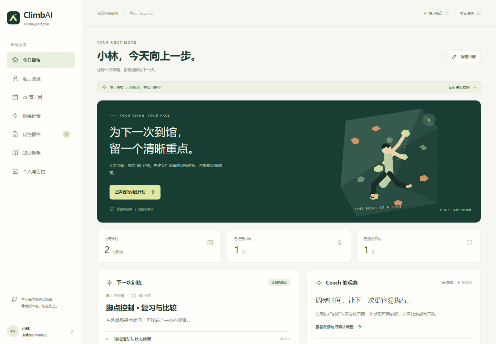

# 周俊涛 AI 产品作品集


**2026-10-22 攀迹更新：** 新增微信原生训练记录与 AI 文字复盘项目，处于开发预览。个人主页新增完整产品案例、精选界面与验证边界；前期 ClimbAI Web 探索保留。

**[攀迹产品案例](https://zhoujuntao611.github.io/ai-product-portfolio/panji/)** · **[攀迹源码与运行说明](projects/panji)** · **[产品文档](projects/panji/docs/PRD.md)** · **[证据与验证范围](projects/panji/docs/EVIDENCE.md)**

## 攀迹 攀岩训练与 AI 复盘微信小程序

个人产品实践，AI 辅助实现。围绕“训练—线路尝试—复盘—下次目标核对”落地 14 个原生页面，支持快捷记录、跨次线路追踪及本机视频回看。接入腾讯混元 hy3 文字复盘，程序生成事实摘要，模型提出建议，用户确认后再形成目标。

根据手机使用反馈，将关联视频放进尝试卡片，完善连续保存和草稿保护。在免费资源约束下，训练可云存储、视频及其关联留在设备；独立授权，备注默认不发送，视频不发送给模型，额度或资源核对失败时保留记录与手写复盘能力。

公共名录快照包含 228 个场所、71 个城市/地区，保留来源、旧名及开放条件；属于部分收录，不代表用户规模或实时营业状态。原工程记录 176 项自动检查、14 页原生编译及 3 类合成场景的真实模型开发验证。公开副本移除私有部署处理器及其 2 项测试，检查范围为 174 项；开发结果不代表用户效果，完整手机验收和公开发布仍待完成。

微信开发者工具中的精选截图使用合成训练内容。此处提供案例与可配置源码，没有可长期公开访问的小程序体验码，不包含开发 AppID、云环境或私人训练数据。运行时请配置自己的账号与环境。


**2026-10-19 模型实践更新：** SupportFlow 24 项模型接入场景由 16/24 提升至 24/24；ClimbAI 跑通预算内计划、反馈与用户确认；验证记录共 47 次成功 API 调用（含同模型对照）。[查看实测与产品迭代](docs/LIVE_PRACTICE_20261019.md)。

面向 AI 应用／Agent 产品经理实习的个人作品，包含微信原生小程序和 Web 应用：客服知识审核、订单 CSV 分析与 ToC 攀岩训练反馈。以产品任务拆解、方案取舍与可运行交付为主线，SupportFlow 与 ClimbAI 已完成 DeepSeek-V4-Pro 真实接入。SupportFlow 可导入结构化政策，MetricPilot 可导入订单 CSV，ClimbAI 提供浏览器演示。产品文档、交互、错误状态、测试和评测记录均随代码提供。

**[个人主页](https://zhoujuntao611.github.io/ai-product-portfolio/)** · **[ClimbAI 在线演示](https://zhoujuntao611.github.io/ai-product-portfolio/climbai/)** · [SupportFlow 源码](projects/supportflow) · [MetricPilot 源码](projects/metricpilot) · [ClimbAI 源码](projects/climbai)

**[三项目迭代证据索引（2026-10-19）](docs/ITERATION_EVIDENCE_20261019.md)**：从具体失败、备选方案和修改，追到冻结基线及逐题结果。所有通过数均为开发验收，不代表真人成功率或真实模型准确率。

## SupportFlow 智能客服工单助手

从政策导入到有效知识、逐条引用草稿和人工审核。支持来源、地区、有效期与版本治理；政策更新拦截旧稿，批准、驳回与转人工均保存编辑稿和原因，并可导出问题样例。

具体问题：用“7 天内申请退款”回答“退款多久会到账”，虽有引用却不支持所问事项。选择同义扩展与逐问题 BM25 检索，并在实际选中条款上检查事项、周期和覆盖；资料不足就澄清。本版不自动发送或办理退款，可选模型只选择已有证据编号，DeepSeek 证据选择已完成真实调用与逐题验收。


[产品需求](projects/supportflow/docs/PRD.md) · [评测方法](projects/supportflow/docs/EVALUATION.md) · [迭代与取舍](projects/supportflow/docs/ITERATION_EVIDENCE.md) · [本轮同 26 题：14 → 26 通过](projects/supportflow/verification/review-comparison-v2.1.json) · [此前同 60 题：33 → 60 通过](projects/supportflow/eval/comparison_v2.json)

## MetricPilot 订单 CSV 分析助手

把订单 CSV 导入、字段映射、质量检查、口径确认、受约束统计和证据报告连接起来。报告保存源文件指纹、源行号、SQL 参数及查询编号，可复核并导出。问题范围受限，遇到不支持的期间、条件和分母先澄清。

具体问题：界面确认原订单日，问题却要求退款发生日，仍静默生成订单日口径结果。同一手算样例两种口径分别为 30 元与 120 元。比较自动覆盖与冲突先确认后，选择冲突时零查询；同时修复混合期间截断和未知分母替换。CSV 入口采用规则解析与受约束统计，聚焦可复核的收入、渠道与退款任务。


[产品需求](projects/metricpilot/docs/PRD.md) · [指标定义](projects/metricpilot/docs/METRICS.md) · [迭代与取舍](projects/metricpilot/docs/ITERATION-20261019.md) · [修复前 11/22](projects/metricpilot/verification/20261019-before.json) · [修复后 22/22](projects/metricpilot/verification/20261019-after.json) · [CSV 版工程报告](projects/metricpilot/docs/eval_report.json)

## ClimbAI AI 攀岩训练助手

面向室内抱石初阶用户的 ToC AI Coach 产品：根据目标、可用时间和训练记录建立有依据的能力画像，通过知识检索与规划生成计划，并将训练反馈转成用户可确认的调整。四节点工作流由画像、知识检索、训练规划、反馈优化组成。

关键取舍是先建立可执行、可回查的训练闭环。未测量的能力保留未知；计划保留版本；训练结束与反馈提交分别保存；用户可以接受调整或保持原计划。知识回答附来源，出现不适暂停相关训练推荐。首版没有视频动作纠错。

知识版本 `demo-kb-1.1` 将原后端 10 条知识扩充为前后端共享的 30 条，保留原 10 个练习模板。18 条带外部参考，12 条为自编产品规则；外部参考来自已核验的 7 个官方页面。条目明确来源、支持范围、适用条件和待教练审核状态，未新增训练强度或负荷处方。



[在线体验](https://zhoujuntao611.github.io/ai-product-portfolio/climbai/) · [产品需求](projects/climbai/docs/PRD.md) · [知识治理与来源](projects/climbai/docs/KNOWLEDGE.md) · [50 条固定检索逐题结果](projects/climbai/verification/knowledge-retrieval-20261015.json) · [源码与运行说明](projects/climbai)

在线体验是可交互浏览器演示，使用本地规则与示例数据，记录保存在当前浏览器。它不调用远程 LLM，也不连接常驻后端。下载源码后可运行 FastAPI、SQLite 和知识检索后端，可接入 LLM API，已实际跑通 DeepSeek 计划生成、反馈归纳与用户确认流程。

## 一键启动

### SupportFlow / MetricPilot

两个原有项目需要 Python 3.10 或更新版本；运行它们的演示不需要安装第三方包或模型密钥。

Windows 下载仓库后，双击 `start-projects.cmd`。结束时双击 `stop-projects.cmd`，关闭启动器创建的本机服务。

其他系统在两个终端分别运行：

```bash
python projects/supportflow/server.py
python projects/metricpilot/app.py
```

打开 http://127.0.0.1:8765 和 http://127.0.0.1:8766。模型配置与端口参数见各项目 README。

### ClimbAI

后端推荐 Python 3.11，固定依赖支持 3.11 / 3.12；前端构建需要 Node.js 22 或更新版本。默认模式不需要模型密钥。先进入 `projects/climbai`，创建虚拟环境并安装依赖。

Windows PowerShell：

```powershell
cd projects/climbai
python -m venv .venv
.\.venv\Scripts\python -m pip install -r requirements.txt
.\.venv\Scripts\python -m uvicorn backend.main:app --host 127.0.0.1 --port 8000
```

macOS / Linux：

```bash
cd projects/climbai
python3 -m venv .venv
.venv/bin/python -m pip install -r requirements.txt
.venv/bin/python -m uvicorn backend.main:app --host 127.0.0.1 --port 8000
```

在另一个终端进入 `projects/climbai`，安装并启动前端：

```bash
npm ci
npm run dev
```

前端源码位于 `web/`，`npm run build` 输出 `dist/`。GitHub Pages 发布仓库中的 `docs/climbai/` 构建结果。前端模式切换、模型配置与数据存储说明见 [ClimbAI README](projects/climbai/README.md)。

## 已验证结果与范围

- SupportFlow：当前 123/123 工程检查通过；同 26 条审阅回归 14/26 → 26/26，此前冻结关键词基线与完整新版流程同 60 题对照 33/60 → 60/60，未做 BM25 单项消融；原有 31 条回归保持通过。[完整分母与原始结果](projects/supportflow/docs/ITERATION_EVIDENCE.md)。
- MetricPilot：最新完整工程检查 162 项通过，CSV 固定业务任务 24/24 通过；同 22 项验收 11/22 → 首次修复 17/22 → 最终 22/22。此前 CSV 版 90 项与旧版 72 项各有独立范围，上述任务有重叠，不能相加扩大独立样本数。[完整记录](projects/metricpilot/docs/ITERATION-20261019.md)。
- SupportFlow 与 MetricPilot 的 10 月 19 日本机浏览器验收分别完成原流程 11/11、12/12，专项各 9/9；原始报告入口见各项目迭代记录。均为自动化流程，不是用户人数。[版本汇总](verification/iteration-20261019.json)。
- ClimbAI：10 月 15 日知识扩充记录为 116 项后端检查通过，其中已包含 50/50 固定检索题；另有 14 项定向浏览器验收通过。扩充回归没有安装或重新验证原生 Chroma，也未调用真实模型。[验证记录及原始报告](projects/climbai/docs/VALIDATION.md)。历史 10 月 14 日工程与浏览器记录单列，不能当作本轮重验。
- **SupportFlow 与 ClimbAI 已完成 DeepSeek 真实接入与记录。** 模型实测及下一阶段用户任务验证见最新报告。

个人主页展示项目案例，ClimbAI 提供明确标注的可交互浏览器演示。Python 应用在本机运行；GitHub Pages 不承担 Python 后端服务。界面体验、运行方式与真实模型实践记录分别提供，便于直接复现。

## 运行验证

```bash
cd projects/supportflow
python -m unittest discover -s tests -v
python evaluate.py
```

```bash
cd projects/metricpilot
python evaluate.py
python evaluate_tasks.py
```

```bash
cd projects/climbai
python -m pip install -r requirements.txt
python -m pytest tests/backend -q
npm ci
npm run build
```

评测脚本会重新生成报告及工程耗时；数字只代表该版本上的已列出场景。后续修改应重新验证。

## 资料与许可

代码从零搭建；SupportFlow 与 MetricPilot 使用 Python 标准库、SQLite 与原生网页，ClimbAI 使用 Python / FastAPI、SQLite、知识检索及 React 前端。既有 Web 项目按各自随附许可；攀迹公共资料含独立的 OSM / ODbL 许可，详见其来源说明，不对第三方数据统一授予代码许可。API 格式参考官方文档，相关链接见项目说明。仓库不包含私人简历、联系方式、真实业务数据、密钥或运行中数据库。
