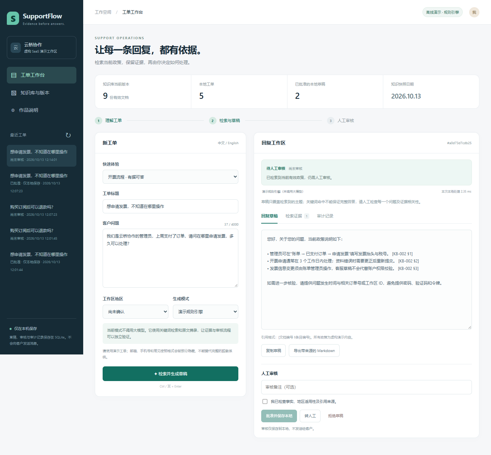
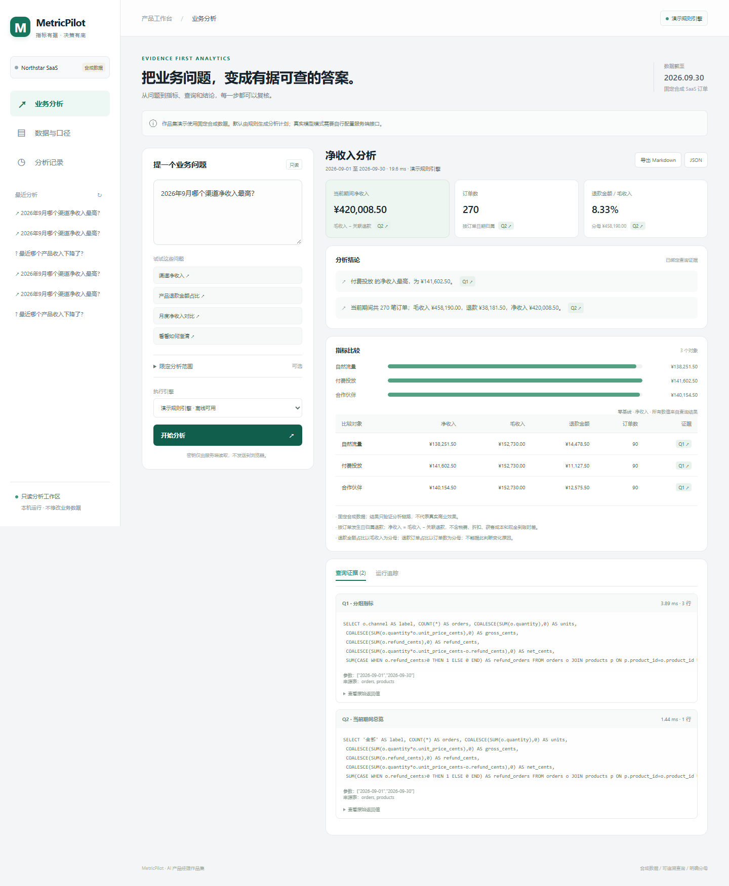

# 周俊涛 AI 产品作品集

面向 AI 应用／Agent 产品经理实习的两个可运行作品：客服知识审核与业务数据分析。项目于 2026 年 10 月由 AI 协作搭建，默认使用规则引擎与合成数据。产品文档、交互、错误状态、测试和评测结果均随代码提供。

**[个人主页](https://zhoujuntao611.github.io/ai-product-portfolio/)** · [SupportFlow 源码](projects/supportflow) · [MetricPilot 源码](projects/metricpilot)

## SupportFlow 智能客服工单助手

从客户问题到有效政策、逐条引用草稿和人工审核。支持地区冲突澄清、知识未覆盖停止作答、高影响请求转人工、版本查看、SQLite 状态与审核记录、Markdown 导出。

关键取舍是先保证依据可检查，再改善措辞；本版不会自动发送或办理退款。默认是关键词检索与原文摘录；可选模型只选择已有证据编号。



[产品需求](projects/supportflow/docs/PRD.md) · [评测方法](projects/supportflow/docs/EVALUATION.md) · [31 条合成回归的实际结果](projects/supportflow/eval_report.json)

## MetricPilot 业务数据分析 Agent

把限定范围的业务问题转成明确口径、只读查询和有引用的报告。支持产品／渠道／期间比较、含糊条件澄清、原始结果与 SQL 核查、运行追踪、历史回看和 Markdown／JSON 导出。

关键取舍是使用受约束的统计工具，保证期间、指标与数据访问边界；它不能回答任意 SQL 或把变化解释为因果。可选模型通过 Tool Calling 选择已确认范围内的查询，最终数字来自查询结果。



[产品需求](projects/metricpilot/docs/PRD.md) · [指标与数据定义](projects/metricpilot/docs/DATASET.md) · [评测方法](projects/metricpilot/docs/EVALUATION.md) · [72 项离线检查的实际结果](projects/metricpilot/eval_report.json)

## 一键启动

需要 Python 3.10 或更新版本；运行演示不需要安装第三方包或模型密钥。

Windows 下载仓库后，双击 `start-projects.cmd`。结束时双击 `stop-projects.cmd`，关闭启动器创建的本机服务。

其他系统在两个终端分别运行：

```bash
python projects/supportflow/server.py
python projects/metricpilot/app.py
```

打开 http://127.0.0.1:8765 和 http://127.0.0.1:8766。模型配置与端口参数见各项目 README。

## 已验证结果与范围

- SupportFlow：31/31 条合成工单回归与 32 项工程测试通过。引用一致性检查覆盖有事实条目的案例；数据集与实现一同编写，不是独立盲测。
- MetricPilot：72/72 项离线检查通过。其中 23 项数值／业务、14 项澄清输入、16 项 SQL 防护／资源、11 项本地模型协议模拟、8 项 HTTP 边界；不是 72 次真实模型业务任务。
- 两个应用已完成桌面与 390px 手机宽度的浏览器交互检查，包含正常任务、异常分支、证据查看、记录与导出。记录见 [浏览器检查](verification/browser-qa.json)。
- **真实供应商模型调用、真实用户测试与商业上线均未完成。** 尚无采纳率、节省工时或真实模型准确率；它们需要单独采集证据。

网页是项目案例展示。Python 应用在本机运行；GitHub Pages 不承担 Python 后端服务。应用包含明确演示模式，不将静态截图称为在线 Agent。

## 运行验证

```bash
cd projects/supportflow
python -m unittest discover -s tests -v
python evaluate.py
```

```bash
cd projects/metricpilot
python evaluate.py
```

评测脚本会重新生成报告及工程耗时；数字只代表该版本上的已列出场景。后续修改应重新验证。

## 资料与许可

代码从零搭建，使用 Python 标准库、SQLite 与原生网页；各项目按随附 MIT LICENSE 许可。API 格式参考官方文档，相关链接见项目说明。仓库不包含私人简历、联系方式、真实业务数据、密钥或运行中数据库。
