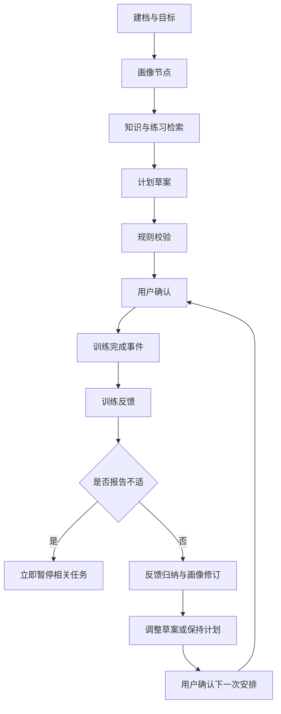

# 页面、交互与验收

当前为已实现产品的页面规格与后续 Figma 制作依据，未创建云端 Figma 文件。

## 八个视图

1. 今日：下一次训练、待确认计划、最近反馈和快捷入口。
2. 建档与目标：经历、等级体系、场地、时间、频次、目标、不适。
3. 能力画像：事实、AI 假设、证据充分度、下一步记录及纠正。
4. 周计划：训练卡、时长、目的、来源、确认与版本。
5. 训练执行与记录：结束训练先保存完成事件，再选择反馈。
6. 反馈报告：观察、假设、修改项、依据、接受或保持。
7. 知识助手：场景问题、来源、库外资料不足、不适边界。
8. 个人与历史：档案、记录、版本、运行追踪、导出和删除。

## 核心工作流

## 验收场景

- 首次进入可以使用自己的资料或明确的模拟样例，未保存档案不伪造画像。
- 时长、频次和字段非法时有可理解提示。
- 计划草案与已确认计划区分；修改保留版本。
- 完成训练但未提交反馈可以在历史中补交。
- 正常反馈生成依据和下一步；保持计划也保存决定。
- 疼痛反馈立即暂停相关任务，禁止接受增加负荷建议。
- 知识问题有来源；库外问题说明不足，不拼凑引用。
- 断网或 API 失败显示失败状态，避免无说明切换为演示输出。
- 浏览器演示数据持久化，并能导出、清空与重置。
- 手机布局无页面水平溢出，按钮可操作；对话框可通过键盘关闭。

## Demo 演示顺序

使用模拟样例建立目标 → 查看画像依据 → 确认周计划 → 结束一场训练 → 提交技术卡点反馈 → 查看调整与版本 → 确认保持或接受 → 询问训练相关知识 → 导出记录。

额外展示疼痛分支和库外问题。演示数据不作为真人试用结果。
