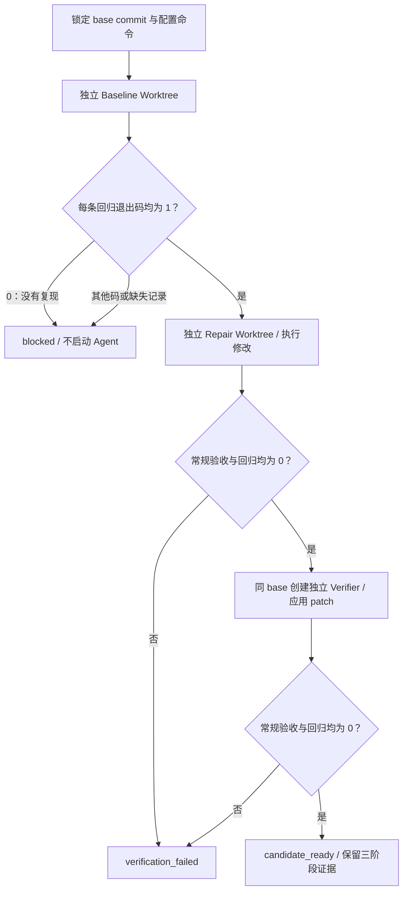

# Oriel 本轮迭代：让修复候选具备回归证据

更新日期：2026-10-27。开发基线为 `afdd62099b900a3c046dd96396268b7a8403d9c4`，本地工作分支为 `codex/oriel-regression-evidence`。本轮代码位于 `work/pico-harness`，并显式导出到 GitHub 作品集的 `projects/oriel/source`。作品集保留原始基线清单，当前版本和后续变更分别校验，不把本轮代码归入上游原始提交。

## 1. 为什么选择这个方向

Oriel 的核心任务是把社区问题变成维护者可以审查的修复候选。现有实现已经有 Repair Worktree 和干净 Verifier Worktree，这能检查“交付的补丁是否可以独立重放”。进一步要回答的是：**配置的检查能否证明本次修改确实改变了缺陷行为？**

例如一个加法函数错误地返回 `a - b`。验收只检查 `total(0, 0) == 0` 时，错误版本也能通过；即便 Agent 只加了一份无关说明，干净验证仍可能全绿。增加模型、界面或框架都不能直接弥补这条证据缺口。

本轮增加维护者明确配置的定向回归检查：先在原版证明失败，再在修复与干净重放后证明通过。它与原有常规验收共同约束候选，而不是替代原验收。

## 2. 实际行为

新增可选配置字段 `maintenance.regressionCommands`，Python 名称为 `regression_commands`。



- **Baseline：**每条定向回归都必须返回 `1`。任一返回 `0`，记录 `baseline_not_reproduced`；其他退出码、超时或记录数量不完整，记录 `baseline_error`。两种情况均为 `blocked`，不启动修复 Agent。
- **Repair：**原 `acceptanceCommands` 必须全部通过，新增回归也必须全部返回 `0`。回归失败记录 `repair_failed`，不进入干净验证。
- **Verifier：**从相同 base 创建干净目录，只应用导出的 patch。原验收与定向回归仍必须全部通过。回归失败记录 `verification_failed`；回归全部通过记录 `verified`，但常规验收仍可否决候选。
- **未配置：**兼容原验收路径，证据明确标记 `mode=acceptance_only`、`status=not_configured`，不宣称已验证问题复现。

Baseline 是第三个独立目录，其测试生成的文件不会直接带入 Repair。三份 Worktree 在结束时清理，候选包与日志保留。基线提交在 Runner 开始执行时解析，而不是承诺排队瞬间已经冻结远程分支。

**候选源码一致性：**补丁与变更文件以锁定的基础提交导出。Repair 完成全部检查后，当前受版本管理的源码差异必须仍与导出的补丁一致；Verifier 使用 `git apply --binary --index` 将补丁及候选新文件纳入核对范围，完成检查后同样比较。任何检查自动改写已有代码、候选新文件或其他受版本管理文件，均拒绝候选；普通检查生成的非候选未跟踪缓存不因此被拒绝。检查命令自行提交修改也不能通过改变 HEAD 绕过固定基线的比较。

这修复了发布前复核实际发现的误报：未修复补丁可能被验收命令临时改好，再通过回归检查。该场景及修复、干净验证阶段的源码改写均加入了回归测试。

Runner 本体拒绝空验收列表和空白命令；工厂在启用维护模式时也做非空检查。配置对象仍允许默认空列表，使未启用维护模式的配置能够正常保存再加载。不能通过删光验收命令得到“全部通过”。

## 3. 怎样配置检查

以下只说明字段含义，是针对上面加法示例的配置片段，不是 Pico 本身的默认验收：

```json
{
  "maintenance": {
    "acceptanceCommands": [
      "python -c \"from calculator import total; assert total(0, 0) == 0\""
    ],
    "regressionCommands": [
      "python -c \"from calculator import total; assert total(2, 3) == 5\""
    ]
  }
}
```

真实项目应由维护者选择能表达具体缺陷的检查。完整的群、维护者、仓库、Runner 私有配置等设置仍参照[飞书维护模式](feishu.zh-CN.md)。不应把示例命令直接套用到没有 `calculator.py` 的仓库。

如果使用 `pytest`，可以选择基线已经存在且覆盖该缺陷的精确测试。若测试是 Agent 修改过程中才新建的，基线没有那个测试，不能把“文件不存在”当成问题已经复现；需要先准备可在基线执行的复现检查。

退出码 `1` 是此功能采用的检查契约。pytest 将 `1` 定义为已运行测试中存在失败；`2`、`3`、`4`、`5` 等有不同含义，不能统称为缺陷复现。[pytest 官方退出码说明](https://docs.pytest.org/en/stable/reference/exit-codes.html)

**只看退出码仍有局限：**任意 Python 异常也可能返回 `1`，其他工具对 `1` 的定义未必相同。维护者必须确认检查本身可用、日志显示的是目标断言失败；必要时用包装程序把加载、配置和依赖异常映射为其他码。本功能不会自行理解失败原因。

## 4. 候选包如何阅读

`manifest.json` 的 schema 升级为 `pico.maintenance.candidate.v2`，保留旧字段，并新增：

- `regression_evidence`：包含 `mode`、`status`、适用范围说明。
- `baseline_regression_checks`：基线执行记录。
- `repair_regression_checks`：修复目录执行记录。
- `verification_regression_checks`：干净验证目录执行记录。
- `checks_source_unchanged`：Repair / Verify 的源码一致性结果；未执行的阶段为 `null`。

每条记录包含 `command`、`exit_code`、日志文件名。日志分别为 `baseline-regression-check-N.log`、`repair-regression-check-N.log` 和 `verify-regression-check-N.log`。没有执行的阶段保持空记录，不伪造成功。

`CANDIDATE.md` 增加 Regression evidence 段落，逐条展示 Baseline / Repair / Verifier 退出码；原有验收结果也继续展示。没有执行的阶段显示 `not run`。

判定时先看整体 `state`，再看回归证据。`regression_evidence.status=verified` 只表示定向回归完成；如果常规验收失败，整体仍是 `verification_failed`。

旧消费者若严格匹配 v1 schema，需要显式支持 v2；不能仅凭“字段大部分不变”认为所有外部解析器天然兼容。当前源码内没有发现严格限制 v1 的生产消费方。

## 5. 同时修复的事务故障

[store.py](../../pico/maintenance/store.py) 的 `create_or_get_proposal()` 和 `create_or_get()` 在插入遇到唯一约束冲突后，会查询已有对象作为幂等返回。原实现遗漏 `rollback()`，导致连接可能仍留在失败的写事务内。

复现场景是：同一 `/issue` 重复提交 → 正常返回已有 Proposal → 下一次预留 `/fix` 或问答配额时执行 `BEGIN IMMEDIATE` → 出现 `cannot start a transaction within a transaction`。其他连接也可能遭遇写锁。

修复只在两个冲突分支先回滚，再查找已有记录。新增四项真实 SQLite 测试，覆盖重复 Proposal、重复 Job、双连接竞争和无法归类为重复的约束异常。代码不会修改既有记录内容或配额规则。

这体现了幂等设计的一个学习点：**重复请求返回了正确对象，还需要保证连接和事务已回到可继续工作的状态。**[Python 3.12 SQLite 事务说明](https://docs.python.org/3.12/library/sqlite3.html#transaction-control)

## 6. 本机验证结果

测试环境：Windows、Python 3.12.14，使用仓库冻结依赖安装开发环境；另为本机 `ZoneInfo` 补装 `tzdata==2026.5`，没有改写依赖锁。新增测试使用真实 Git、SQLite 和 Python 子进程；Windows 测试适配器仅把固定 Python 检查转为直接执行。

2026-10-26 的首轮合并回归为 **128 passed、4 deselected**。2026-10-27 发布前复核增加了验收改写源码、候选新文件、固定基线等场景；最新本机数量、命令与演示结果见[验证摘要](../examples/maintenance-iteration-verification.json)。四项排除的是两个依赖生产 POSIX shell 路径的原有测试、两个依赖 POSIX 文件权限的原有测试。配置测试有一条已有兼容字段弃用提醒。

可在本地开发仓库复跑这组 Windows 范围检查：

```powershell
.\.venv\Scripts\python.exe -m pytest `
  tests/test_maintenance_regression.py tests/test_maintenance_store_transactions.py `
  tests/test_maintenance.py tests/test_config_pico_loader.py `
  tests/test_config_cfg1.py tests/test_config_loader.py -q `
  -k 'not runner_replays_patch_and_writes_candidate_packet and not runner_keeps_patch_but_fails_closed_when_clean_verifier_fails and not factory_rejects_world_readable_gitee_token and not factory_uses_private_runner_home_and_never_requires_github_credentials'
```

Linux / macOS / WSL 应按原安装说明运行完整维护测试，包含原有 shell 和权限检查。新增回归测试仅在 Windows 适配固定 Python 命令，Linux 使用生产 `/bin/sh` 路径。GitHub 的 Oriel 检查运行全部维护、回归、事务和相关配置测试，并保存 JUnit 与演示候选包；实际状态以对应提交的 Actions 结果为准。本机适配测试不等于完整 POSIX 部署验收。

## 7. 无需账号的演示

入口：[demo_maintenance_regression.py](../../scripts/demo_maintenance_regression.py)。在工作仓库运行：

```powershell
.\.venv\Scripts\python.exe scripts/demo_maintenance_regression.py
```

其他系统安装好依赖后可运行：

```sh
uv run --frozen --extra dev python scripts/demo_maintenance_regression.py
```

演示为五个情景创建各自的临时 Git 仓库：正确修复、只改无关内容、基线已经通过、基线检查异常、修复目录通过但干净重放失败。五个情景均按预期进入终态，并核对原仓库没有修改、工作目录已经清理。

输出位于 `.pico/evidence/maintenance-regression/run-*/`，包括 `report.json` 和各情景的候选包。每次生成新目录，便于保留和比较。正确修复应看到回归退出码 `[1] → [0] → [0]`。

编辑器是确定性夹具：它按情景写入预设修改，未调用真实模型。这验证了编排、状态、补丁重放和证据产出，不能据此给出模型修复成功率、社区采纳率或节省工时。Windows 演示适配器只处理脚本自带的固定 Python 命令，不支持任意 shell，也不改变生产 Runner 的系统支持范围。

## 8. 实现入口与学习重点

- [config/pico.py](../../pico/config/pico.py)：新增字段与空白命令检查，学习默认配置和显式配置的往返兼容。
- [maintenance/factory.py](../../pico/maintenance/factory.py)：启用时校验并向 Runner 传递配置。
- [maintenance/runner.py](../../pico/maintenance/runner.py)：三阶段执行与失败关闭、证据完整性、候选包 v2。
- [maintenance/store.py](../../pico/maintenance/store.py)：唯一约束冲突后的事务清理。
- [回归验收测试](../../tests/test_maintenance_regression.py)：行为契约、真实临时仓库与失败路径。
- [事务回归测试](../../tests/test_maintenance_store_transactions.py)：同连接后续可用性与多连接写锁。
- [完整技术栈学习指南](oriel-tech-stack.zh-CN.md)：将这次修改放回 Runtime、工具、上下文、界面和评测的全貌。

本轮重点是提高维护者对候选的判断依据。Worktree 仍不构成安全容器，命令内容固定也不保证补丁不能削弱所引用的测试文件；验收覆盖、测试内容审查与运行隔离仍有各自责任。是否修复了真实 Issue，最终要结合具体问题、代码审查和对应验收判断。
