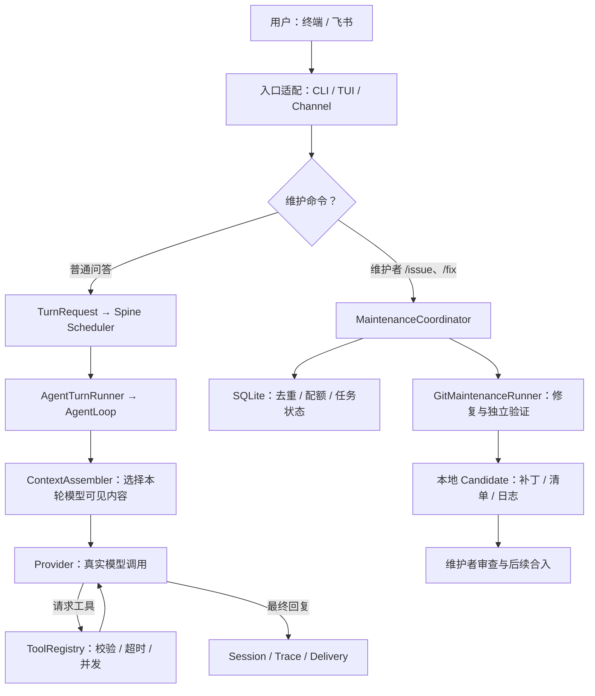

# Oriel 技术栈与源码学习指南

核对日期：2026-10-27。面向希望理解项目、亲手验证并在求职中准确讲述的读者。

Oriel 是“开源维护者 Agent”这一产品场景；Pico 是支撑它的通用 Agent Runtime；PicoBench 是评测工具。理解项目的重点是：**怎样把一个会生成文本的模型，组织成有状态、有权限、有验收证据的工作流程。**

本文以本工作仓库源码为准。开发发生在 `work/pico-harness`，GitHub 作品集的 `projects/oriel/source` 通过显式导出同步。本轮将原上游基线与后续修改分别记录在基线、当前源码和变更清单中；发布版本以作品集清单为准。源码同步与真实服务部署分别处理，模型、飞书、Gitee 等外部链路需要对应环境单独验收。

## 1. 先建立整体认识



普通问答和维护任务共用 Runtime 能力，但不是每条 `/fix` 都被当作一条普通对话去执行。维护协调器先识别命令、授权和配额，再调用修复执行器；执行器在独立目录里启动 Pico Agent。

这个项目主要是**本地或后台运行的 Python 应用，加一套 Node 终端界面**。TUI 中用了 React，但它没有浏览器 DOM，也不意味着项目用了 Next.js。当前维护数据是 SQLite，对话是 JSONL；源码没有要求用 PostgreSQL、Redis 或 Kubernetes 才能运行。作品集网站是另一个展示层，不能把展示网站的技术栈混进 Agent Runtime。

## 2. 技术清单：每种技术承担什么责任

以下是依赖文件里的**声明范围**，不是当前机器已安装的版本，也不是对最新版本的推荐。精确解析结果应看锁文件，实际安装结果应在具体环境检查。

### 2.1 Python 运行时与配置

参照 [pyproject.toml](../../pyproject.toml)。

- **Python `>=3.12,<3.13`**：主业务语言。`asyncio` 承担模型网络请求、工具等待、消息收发和任务调度；`dataclasses`、`StrEnum`、`Protocol` 描述数据和接口。
- **Typer `>=0.20.0,<1.0.0`**：把 Python 函数组织成 `pico run`、`pico gateway`、`pico sessions` 等命令。入口声明是 `pico = pico.cli.commands:run`。
- **Pydantic `>=2.12.0,<3.0.0`、pydantic-settings `>=2.14.2,<3.0.0`**：读取并校验配置，把文件字段转换成类型明确的对象。[schema.py](../../pico/config/schema.py) 管基础配置，[pico.py](../../pico/config/pico.py) 管 Context、Runtime、Maintenance 等功能配置。
- **PyYAML `>=6.0`、tomli-w `>=1.2.0`**：配置读写。配置格式与业务逻辑分离，便于同一套 Runtime 服务不同入口。
- **Rich `>=14.0.0,<15.0.0`、Loguru `>=0.7.3,<1.0.0`**：命令行输出与日志。它们负责展示和诊断，不能代替任务状态存储。

Pydantic 能判断“`max_concurrent_jobs` 是否为合法数字”，不能证明模型凭据有效、飞书机器人已发布或验收命令真实存在。配置校验与运行探测是两个层次。

### 2.2 模型、网络和工具

- **LiteLLM `>=1.82.1,<1.92.0`**：适配不同模型服务的调用格式；项目还保留专用 Provider，不能简化成“所有调用都经过 LiteLLM”。
- **httpx `>=0.28.0,<1.0.0`**：异步 HTTP 客户端，用于模型或业务 API。模型客户端做的是网络请求，推理主要发生在外部模型服务。
- **MCP `>=1.27.0`**：接入外部工具服务器。MCP 是工具连接与调用协议，既不是模型，也不是一套独立推理能力。
- **tiktoken `>=0.7.0,<1.0.0`**：支持 Token 估算。预算估算与 Provider 返回的实际用量分别记录。
- **json-repair `>=0.30.0`**：辅助处理不完全合法的 JSON；修好语法后仍需校验参数，不能把格式可解析等同于业务安全。

可选渠道依赖包括 `lark-oapi >=1.5.0,<2.0.0`、企业微信和 QQ SDK。只有启用相应渠道才需要该部分能力。项目内的 [FeishuChannel](../../pico/channels/adapters/feishu/channel.py) 与 [飞书文档](feishu.zh-CN.md) 说明 WebSocket 长连接接入；这条渠道连接和 TUI 的本地 RPC 是两套通信链路。

### 2.3 存储、隔离与工程工具

- **SQLite，Python 标准库 `sqlite3`**：维护任务、Issue Proposal、每日配额的结构化状态。
- **JSONL + portalocker `>=3.2.0` + 原子文件操作**：持久化会话消息、控制并发文件写入。
- **Git Worktree、Git Patch**：锁定同一基础提交，分离修复目录和干净验收目录。
- **BoxLite `==0.9.5`，可选依赖**：一种隔离执行后端；维护检查还支持配置 Docker 镜像。依赖中有隔离组件，不等于当前机器已经部署并验证隔离。
- **uv + uv.lock + Hatchling**：依赖锁定与 Python 打包。Hatch 自定义构建钩子可把预构建 TUI 放进 wheel。
- **pytest、pytest-asyncio、Ruff**：功能验证、异步测试和静态检查。项目默认排除真实模型、真实渠道、真实 VM 等需要外部环境的测试。

`numpy >=2.0,<3.0` 用于 KNN 等可选能力；`torch`、`transformers` 位于可选 retrieval 依赖。**不能因为依赖清单出现机器学习库，就声称当前维护流程训练了一个模型或必然启用了向量数据库。**

### 2.4 终端交互层

参照 [ui-tui/package.json](../../ui-tui/package.json)。

- **Node.js `>=22`**：运行终端界面进程。
- **TypeScript `^5.7.0`、React `^19.2.4`**：用组件和类型组织复杂交互。
- **Ink `^6.8.0`、本地 `@hermes/ink`**：把 React 组件渲染为终端内容；本地包包含上游基础和项目修改，来源见 [NOTICES.md](../../NOTICES.md)。
- **Nanostores `^1.2.0`、@nanostores/react `^1.1.0`**：管理界面响应式状态。
- **esbuild `~0.28.1`、tsx `^4.19.0`**：构建与开发运行。
- **Vitest `^4.1.3`、ink-testing-library `^4.0.0`、ESLint / Prettier**：交互测试、检查与格式化。
- **JSON-RPC 2.0 + OpenRPC Schema**：连接 Node 界面和 Python 主进程；从统一 Schema 生成 TypeScript 契约，避免两侧手写结构逐渐不一致。

这是“两种语言各做擅长的部分”的取舍：Python 集中处理 Agent 和生态接口，React/Ink 组织交互。成本是要维护进程生命周期、协议版本和事件状态。若界面很简单，纯 Python Rich / prompt-toolkit 更省维护成本；若需要浏览器多用户访问，则需要另行设计 Web 服务、认证和部署，不能直接把终端组件称为 Web 应用。

## 3. 顺着一条消息理解端到端执行

### 3.1 普通用户问答

建议同时打开 [turn.py](../../pico/spine/turn.py)、[scheduler.py](../../pico/spine/scheduler.py)、[spine_runner.py](../../pico/agent/spine_runner.py) 和 [AgentLoop](../../pico/agent/loop/main.py)。

1. **入口归一化。** CLI、TUI 或 Channel 把消息转换成 `TurnRequest`。`text` 是载荷，`source` 是来源与回复地址，`conversation` 是会话归属，`origin` 是用户、定时任务或子 Agent 来源，`busy` 表示会话忙时的处理方式。
2. **调度。** `Scheduler.submit()` 选定 conversation Lane，`Lane` 负责队列和 Worker。同会话保序，不同会话在并发额度内运行。返回的 `TurnHandle` 用来观察结果或请求取消。
3. **适配具体执行器。** `AgentTurnRunner.run()` 委托 `AgentLoop.run_turn()`。Spine 依赖 `TurnRunner` 接口，避免通用调度器直接导入完整 Agent 实现。这是依赖反转：调度只关心“可运行一个 Turn”。
4. **加载会话并组装上下文。** `AgentLoop._assemble_context_messages()` 调用 `ContextEngine.assemble()`。磁盘里有一千条消息，不代表模型本轮一定看到一千条。
5. **调用模型。** `AgentLoop._run_agent_loop()` 通过 Provider 发起调用；流式路径输出增量，非流式路径一次返回。真实请求的用量和状态由 CallEfficiency 包装记录。
6. **执行工具并继续循环。** 模型返回工具名和参数，主机通过 `ToolRegistry.execute_many()` 校验和执行，把结果按 `tool_call_id` 配回消息，再让模型决定下一步。模型输出“我要运行测试”只是请求，真正执行在主机工具层。
7. **结束并保存。** 会话记录、追踪、回复投递分别处理。Worker 发出 `TurnEnded` 或 `TurnFailed` 并完成 handle；模型成功回答和消息实际投递成功仍要分别观察。

可以把循环理解为：**模型提议下一步 → 程序执行并反馈事实 → 模型读取事实继续决策**。这比“把 Prompt 发给模型”多出状态管理、权限、超时、取消、错误归一化和证据记录。

### 3.2 维护者 `/issue` 与 `/fix`

入口见 [MaintenanceCoordinator.handle](../../pico/maintenance/coordinator.py) 和 [factory.py](../../pico/maintenance/factory.py)。

`/issue` 从原消息得到摘要，创建本地 Proposal，再按配置创建 Gitee Issue，保存原消息与外部 Issue 的关联。`/fix` 校验允许群和维护者，解析 Issue、去重、检查配额，持久化任务，再由 `_execute()` 调用 Runner。

授权判断来自结构化的群和 sender ID，不能让模型凭消息“我是管理员”自行决定。Issue 文本是待处理的数据，也不能因为写在 Issue 里就获得新的工具权限。

Runner 见 [GitMaintenanceRunner.run](../../pico/maintenance/runner.py)：锁定 base commit，准备 Repair Worktree，启动修复 Agent，导出补丁，在 Repair 中跑验收，然后建立同 base 的干净 Verify Worktree，应用补丁，再跑验收。最终写入 Candidate 包及终态，维护者再决定后续采纳。

## 4. asyncio：项目最值得学的基础能力

### 4.1 并发不等于 CPU 并行

`await` 表示协程在等待可异步完成的工作时交出控制权。模型网络请求等待 2 秒时，事件循环可以处理其他会话的消息。多个任务的等待时间重叠叫并发；同一时刻由多个 CPU 核执行计算才是另一层面的并行。

`asyncio.gather()` 能调度多个协程，但不会自动把阻塞磁盘操作或纯 Python 重计算移到其他核。同步函数在事件循环里长时间运行仍会卡住其他任务。Python 官方文档将 Task 描述为协作式调度，遇到阻塞工作需要显式考虑线程、进程或异步接口。[Python 3.12 asyncio 文档](https://docs.python.org/3.12/library/asyncio-task.html)

### 4.2 为什么同一个会话反而要串行

假设同一会话同时收到“把配置改为 A”和“基于刚才结果再改为 B”。如果两次执行都从旧历史读起，可能后写覆盖、答复错序、工具上下文串用。`Lane` 把同 conversation 的 Turn 排成队列，让下一轮看到上一轮完成后的事实。

这种一致性边界是 conversation，不能外推为整个仓库的所有文件写入已经互斥。两个会话操作同一外部资源时，仍需资源自身的锁、事务或版本校验。

### 4.3 为什么要分用户池和系统池

`OriginPools` 有两个独立 `asyncio.Semaphore`：USER 使用用户池，CRON / SUBAGENT 结果注入使用系统池。后台任务占满系统池时，用户仍有自己的执行名额。两池不借槽，也没有额外的总池；容量之和是这层设计的总额度。

这是产品体验与资源利用率的权衡：隔离能减少长后台任务挤压用户的机会，但空闲池的名额也不会自动借给另一边。这里的槽位约束 Runtime 的执行域，不等于精确限制供应商每秒请求数或 Token 速率。

### 4.4 三种忙时策略与取消

- `APPEND`：排队等待，适合默认有序处理。
- `INJECT`：在模型与工具之间的安全间隙合入当前 Turn；没被合入就回退排队。它不是任意时刻改写正在发出的模型请求。
- `INTERRUPT`：请求取消当前 payload，再把新 Turn 放到队首。新的任务仍由同一 Worker 接管。

Worker 是运行中 Turn 的 terminal future 唯一完成者。其他调用方请求取消 Task，但不抢先给 future 写结果，从而避免“界面显示已结束，清理仍在跑”或重复完成。取消也不是强制回滚：已创建的文件、已发送的外部请求，需要具体工具的补偿或清理逻辑。

对应学习测试：[scheduler](../../tests/test_spine_scheduler.py)、[pool](../../tests/test_spine_scheduler_pools.py)、[lane](../../tests/test_spine_scheduler_lane.py)。看断言比只读实现更容易理解“哪些情况必须保持成立”。

## 5. 模型与工具：把不确定决策包在确定接口里

### 5.1 Provider 是适配层

[LLMProvider](../../pico/providers/base.py) 统一 `chat`、`chat_stream`、错误分类和重试接口；[LiteLLMProvider](../../pico/providers/litellm_provider.py) 是具体实现之一。

`LLMResponse` 统一内容、工具请求、结束原因、usage 和错误分类，`ToolCallRequest` 保存工具名、参数和 ID。这样 AgentLoop 可以关注“下一步是否有工具调用”，不用在主循环里为每家供应商分支处理原始响应。

收益是更容易换模型、测试和归一化证据；成本是要处理供应商在工具调用、缓存、usage、流式事件上的差异。使用适配器不意味着模型之间完全等价。模型 fallback 会影响行为和成本，严谨实验通常要禁止隐式换模型。

### 5.2 ToolRegistry 是统一执行入口

[ToolRegistry](../../pico/agent/tools/registry.py) 从名字找到 Tool，转换并校验参数，执行、应用超时、统一失败形式、发观察事件。

最有学习价值的规则是：**只有 `READ` 且 `concurrency_safe=True` 的连续工具段可以批量并发，其余按原顺序执行。** 例如“读取 A、读取 B、写入 C、读取 C”可以先并发读 A/B，等它们完成后写 C，再读 C，不能为了速度把最后一次读取挪到写入之前。

普通工具有默认超时；Ask User 这类显式交互工具不套同样的自动超时。`execute_many()` 捕获取消或失败时会取消并等待关联子任务，避免后台留下不受管理的协程。

工具 Schema 校验只判断参数结构，业务权限在对应工具、确认、隔离和调用方策略中实现。Registry 也不能通过返回值猜测用户目标已经完成。测试见 [execution](../../tests/test_tool_registry_execution.py) 与 [timeout](../../tests/test_tool_registry_timeout.py)。

### 5.3 MCP 扩展接入，不替代权限设计

[mcp.py](../../pico/agent/tools/mcp.py) 把外部 MCP 工具注册进统一 ToolRegistry。主机仍需决定哪些工具暴露给模型、是否需要确认、是否允许写入以及怎样超时。

工具很多时，把所有 Schema 每次都塞入上下文会增加输入。项目的 Tool Search / Disclosure 能选择需要公开的工具，代价是额外选择步骤和误选风险。减少 Schema Token 只能先证明输入缩小；若成功率下降或多次搜索变慢，不能直接宣布总体优化。

## 6. Context、Session、Memory、Skill 分别是什么

### 6.1 Session：发生过什么

[SessionManager](../../pico/session/manager.py) 管理 append-only JSONL 消息历史。正常保存只追加新消息；清空、撤销、分叉等操作有独立路径和并发边界。

JSONL 的优点是逐行可读、便于追加和导出；代价是跨行修改、复杂查询与多进程覆盖处理更麻烦。项目通过文件锁、原子替换、Storage Epoch 等机制防止旧写入者覆盖新状态。Session 是消息事实，不是完整进程快照；读回旧对话不会自动恢复一个已停止的 shell 进程。

### 6.2 Context：本次到底给模型看什么

[build_context_engine](../../pico/context_engine/factory.py) 目前只构造一个 `ContextAssembler`。旧配置里的 `engine: legacy/curator/default` 仅作兼容，不应讲成三种当前可切换的引擎。

[ContextAssembler.assemble](../../pico/context_engine/assembler.py) 分两阶段：

1. Phase A 并发构造 identity、bootstrap、memory、active skills、router skills 等独立段落，得到固定前缀。
2. Phase B 在前缀、当前用户消息和工具 Schema 已知后，运行 Curator 选择历史。

两阶段有先后依赖；阶段内部代码使用 `gather`，不能笼统说“所有内容串行拼接”。最终结构是 `[system, *history, user]`，Tool definitions 从独立参数传给 Provider，也计入预算。

[TokenBudget](../../pico/memory_engine/base.py) 为输出、系统提示和工具预留额度，把余额交给历史。忽略工具 Schema 或输出预留，会出现“历史看起来没满，实际请求却超窗口”。估算用于规划，最后仍以真实 Provider usage 作为调用计量依据。

还要区分“本轮初始上下文组装”和“本轮中的每一次调用”。主循环开始后会继续追加 assistant 工具请求与工具结果，再发起下一次模型调用；不应把代码讲成每次工具调用后都重新从空历史组装。累积结果可能再次撑满窗口，AgentLoop 另有有界的超窗收缩与重试路径。

### 6.3 Curator：历史太长时怎样保留关键事实

[CuratorSegmentBuilder](../../pico/context_engine/segments/curator.py) 有三条路径：历史较短时直接通过；较长时用有步数和超时上限的内部模型整理；超时、Provider 错误、非法计划等情况回到确定性 fallback。

fallback 根据受保护的开头、相关性、最近历史等规则选择，不让上下文整理失败直接阻断主 Agent。结构检查还要保证 `assistant tool_calls` 与 `tool` 结果成组，不产生孤立工具消息，相关实现见 [HistoryTrimmer](../../pico/context_engine/history_trimmer.py)。

默认 `curator_model` 在配置里有具体模型名，但配置不证明当前 Provider 支持它；不能说“每次都由轻量模型成功压缩”。更准确的说法是“短历史免调用，长历史尝试有界整理并保留降级路径”。

### 6.4 Memory：跨会话保留有用信息

[MemoryBackend Protocol](../../pico/memory_engine/backend.py) 定义外部后端契约。它提供长期记忆能力，和 Session 的完整聊天记录分工不同；被记住的事实仍可能陈旧，需要来源、适用范围和更新规则。

当前发布路径允许关闭 Memory，不捆绑外部 Myna 实现。`backend=None` 只关闭 Memory 段，不影响本地 Skill 选择。不能把“设计了记忆后端接口”写成“已经自研并上线一套向量数据库记忆系统”。

### 6.5 Skill：可复用的做事方法

Session 记录“上次发生了什么”，Memory 保存“以后可能有用的事实”，Skill 描述“遇到某类任务如何做”。[LocalPool](../../pico/memory_engine/skill_local/local_pool.py)、[SkillRegistry](../../pico/memory_engine/skill_local/registry.py)、[SkillForgeRouter](../../pico/memory_engine/skill_forge/router.py) 负责本地候选与选择。

Skill 进入 Prompt 会影响模型决策，但不会改变模型权重，也不保证适用于当前仓库。检索得分高仍可能误选，所以要看适用条件、负例和人工激活。Runtime 中有 Evolver，不表示 Oriel 维护 Candidate 已自动接入“修复经验 → Skill → 自动激活”的完整业务管线。

## 7. TUI RPC：响应成功、任务完成、交付成功要分开

[Python RpcServer](../../pico/tui_rpc/server.py) 和 [Node TuiRpcClient](../../ui-tui/src/tuiRpcClient.ts) 连接两个进程。当前生产拓扑是本地 TCP loopback，加初始认证 token，随后使用换行分帧 JSON-RPC；代码还保留旧 POSIX pipe 测试路径。不要只根据旧注释把全部实现描述成 Unix Domain Socket。

JSON-RPC 请求用 `id` 关联响应，无 `id` 的 notification 不等待对应响应；协议本身不规定用 HTTP 还是 socket。[JSON-RPC 2.0 规范](https://www.jsonrpc.org/specification)

本项目中，RPC handler 返回可能只证明调用已被接收或注册。流式内容、工具进度和任务终态通过事件继续到达。所以界面至少需要区分：

- **传输就绪**：认证和 `system.hello` 握手完成。
- **任务运行中**：Scheduler / Worker 已开始执行；中间收到 token 或工具事件。
- **任务终态**：Worker 发出结束或失败，取消也要进入有清理的终态路径。
- **交付状态**：最终文本、媒体是否投递成功；不等于模型是否已生成。

服务器按帧创建独立 dispatch task，避免一个长订阅阻塞所有 RPC；写端共用 `asyncio.Lock`，避免并发发送把字节交错成损坏 JSON；帧上限为 1 MiB。输入、运行、写回三个阶段的并发规则各有责任。

协议的事实来源见 [OpenRPC Schema](../../ui-tui/rpc-schema/openrpc.json)，生成流程见 [gen-rpc-types.mjs](../../ui-tui/scripts/gen-rpc-types.mjs)。类型检查防字段漂移，运行时仍需要处理断连、超时、未知事件和版本不兼容。

## 8. SQLite：去重与配额为什么需要事务

[MaintenanceStore](../../pico/maintenance/store.py) 保存三个主要事实集合：`maintenance_jobs`、`issue_proposals`、`daily_quota_events`。

`source_message_id` 的唯一约束帮助识别同一条命令重复送达；针对 `issue_key` 的部分唯一索引防止同一 Issue 在 queued / running / candidate_ready 状态重复启动。单靠 Python 里“先查一下，再插入”会留下竞争窗口，数据库约束才是冲突时的最后一道检查。

配额执行 `_reserve_quota()` 时先 `BEGIN IMMEDIATE`，在同一事务内检查重复、读取计数并预留事件，成功后提交，拒绝或异常则回滚。这样两个请求不会都读取到“还剩一次”后各自通过。SQLite 是嵌入式数据库，适合单机持久状态；如果发展成多实例高写入服务，需要重新考虑数据库连接、锁等待与集中调度，而不是只加几个进程。[Python sqlite3 文档](https://docs.python.org/3.12/library/sqlite3.html)

本轮修复处理了一个典型边界：插入发生 `IntegrityError` 后，需要先结束失败事务，再查询已有对象并返回幂等结果。否则表面上“重复请求已处理”，连接可能仍留在事务中，后续显式 `BEGIN IMMEDIATE` 会失败或其他连接遇到锁。这说明**返回值正确与数据库状态正确是两件事**。

去重、事务、幂等分别回答不同问题：重复如何被识别；一组修改如何共同提交或放弃；再次执行是否会产生额外效果。SQLite 内成功只约束本地状态，不能原子地覆盖 Gitee 外部网络请求。网络创建成功但本地记录前崩溃，是跨系统工作流仍需处理的窗口；不能宣称全链路 exactly-once。

## 9. Git 独立验收：为什么“Agent 说修好了”不够

Git Worktree 能让同一仓库拥有多个工作目录，共享对象库而分离工作区。[Git Worktree 官方文档](https://git-scm.com/docs/git-worktree)

Oriel 把修复和验收放在不同目录。Repair 中可能有未入补丁的临时文件、安装残留或环境状态；如果验收只在 Repair 内通过，交付一个不完整 patch 就可能失败。Verify 从同一 base 创建，在那里只应用候选 patch，可以验证“补丁是否足够独立重放”。

但干净目录中的测试通过，仍只对配置的检查成立；若验收漏掉缺陷，或测试本身被改弱，独立目录不会自动识别全部问题。检查命令还可能自动改写代码，因此本轮也核对检查结束时的源码与候选补丁一致，避免检查时临时修好、交付补丁仍有错误。Worktree 不是安全隔离边界；容器、权限和网络范围是另一层设计。

本轮深化增加可选 `regression_commands`，让维护者配置缺陷回归检查：同一回归命令在干净 base 必须以退出码 `1` 复现，在 Repair 和干净 Verify 必须以 `0` 通过，所有原有 acceptance checks 仍需通过。没有配置时保持原有验收路径。

它补上的证据是“选定的回归检查确实区分了修复前后”，不能扩大成“任意失败都证明复现成功”。精确接纳约定的退出码 `1`，可以排除退出码不为 `1` 的执行错误和超时；普通 Python 异常仍可能返回 `1`，需要维护者核对日志，确认失败来自目标断言。维护者仍须选一个能表达问题的检查；详细范围见[本轮迭代说明](maintenance-regression.zh-CN.md)、[回归验收测试](../../tests/test_maintenance_regression.py)和 [Runner 实现](../../pico/maintenance/runner.py)。

## 10. CallEfficiency、Trace 与 PicoBench：三种证据各说什么

### 10.1 调用事实和执行链路

[CallEfficiencyProvider](../../pico/call_efficiency/provider.py) 使用装饰器模式包裹真实 Provider，尽量不改变主调用接口，在普通、重试、流式、失败、取消等路径记录实际调用事实。[CallEfficiency](../../pico/call_efficiency/runtime.py) 处理准备、缓存策略、usage 和记录。

一个用户 Turn 可能有多次模型调用；一次逻辑请求也可能因重试有多次真实 attempt。若只统计最终成功响应，会漏算失败与重试开销。缓存 Token、估算成本和成功任务数要保留清晰分母。

稳定前缀也有具体工程含义：尽量保持常用系统段、工具定义及历史顺序一致，把每轮变化的时间等 Runtime 信息放在当前用户内容中，减少前方变化导致后续前缀难以复用。`ContextAssembler._build_user()` 正是把 Runtime 信息放进本轮 user 消息，Session 持久化时剥离动态前缀。不过是否命中缓存仍取决于供应商规则和真实返回用量，不能仅凭 Prompt 看起来稳定就假设节省已经发生。

[Tracing](../../pico/tracing/) 则回答“请求经过哪些阶段，哪里慢，哪个工具失败”，用关联标识把 Turn、模型调用、工具与投递串起来。Trace 可解释行为，Call Record 可计量调用，两者都不能单独证明业务问题已经修好。

### 10.2 PicoBench 如何判断改进

入口见 [PicoBench README](../../benchmarks/picobench/README.md)、[Suite](../../benchmarks/picobench/suites/agent_application_ship_1.yaml) 与 [评测索引](../evaluation/README.md)。它的核心思想是冻结任务、模型、预算和 Verifier，保留产物，让报告能从终态证据重建。

学习时要关注四个问题：

1. **只改了什么？** 比如稳定前缀与扰动前缀，比较的是这一轴，不能叫做整个产品改版的因果效果。
2. **怎样算成功？** 测试或外部 Verifier 检查产物，不由模型自评一句“完成”决定。
3. **怎样算效率？** 单位成功任务成本、延迟、Token、失败与重试要共同看；Schema Token 少不等于总费用少。
4. **哪些结果有资格支持结论？** `measurement_valid`、`claim_eligible`、缺失证据、超时和基础设施失败均影响可解释范围。

固定构造任务的全通过不等于真实社区修复成功率。重复三次也不等于三个独立任务；多次重复应按原始任务聚类或明确独立单位。估算费用不是供应商账单。发布文档有历史摘要而原始付费记录未公开时，只能说“文档报告了该结果”，不能说本轮已经独立复现。

本地无需凭据的 smoke 可先验证调度、Runtime、MCP 与产物重建链路。它不能证明真实模型质量。真实模型、真实飞书、真实 VM 测试由标记和独立开关控制，需要相应环境与费用安排。

## 11. 怎样理解主要选型与替代方案

**自定义 Runtime 与通用 Agent 框架。** 这里的代码把 Turn、Lane、Context、工具和证据边界做得很明确，适合需要精确控制取消与验收的场景。使用成熟框架可能更快接入现成功能，但要核实框架是否暴露相同的状态和生命周期控制。自定义不是天然更先进；价值在于边界明确、能验证，而成本是自行维护复杂行为。

**单机 SQLite 与远程数据库。** SQLite 减少部署负担，便于个人项目和单机 Gateway；多实例、远程查询与高并发写入才会加强迁移需求。应先描述真实工作负载，再决定是否需要 PostgreSQL，而不是为了简历增加服务数量。

**JSONL Session 与全存数据库。** JSONL 易于审查和回放，对消息追加很自然；数据库更便于复杂筛选和关联查询。两者都要处理并发、版本和敏感信息，存储方式本身不会自动提供“永久安全记忆”。

**规则 fallback 与完全交给模型。** 在预算、状态、权限、超时和退出码这些确定性边界上，程序规则更可检查；理解 Issue、选择修复方案则适合模型。Curator 的 fallback 是这种分工的例子。

**独立验证与追求全自动合入。** Candidate 保留维护者审查环节，降低错误修改直接进入主分支的风险，但增加人工步骤。只有当真实采用反馈、验收覆盖和授权流程逐步成熟，才有依据考虑更自动化的交付。

## 12. 七天阅读与动手安排

每天按“先理解问题 → 读两个关键文件 → 做一个小验证 → 自己讲一遍”的顺序，约 60—90 分钟。以下命令是学习建议，不代表本轮已全部执行。Python 需要 3.12；完整维护 Runner 的 shell 验收使用 Linux、macOS 或 WSL。原生 Windows 的 TUI 可运行范围与维护执行器支持范围要分别核对。

### 第一天：讲清产品和数据流

读本指南第 1—3 节、[README](../../README.zh-CN.md) 和 [maintenance/models.py](../../pico/maintenance/models.py)。自己画出 `/issue → /fix → Candidate → 维护者审查`，写出普通问答与修复任务的不同终态。完成标准：不用“智能体自动闭环”等抽象词，也能向别人解释输入、输出和人工决策点。

### 第二天：学习协程、队列和取消

读 `TurnRequest`、`OriginPools`、`Lane.submit`，再看 scheduler 的同会话保序测试。独立写一个小练习：两个会话各提交两条异步任务，观察同会话有序、跨会话等待重叠。把一次取消放在排队阶段、一次放在执行阶段，解释为什么清理和结果完成者需要明确。

```sh
uv run --frozen --extra dev pytest tests/test_spine_scheduler.py tests/test_spine_scheduler_pools.py -q
```

### 第三天：追踪一次模型与工具循环

读 `AgentLoop._run_agent_loop`、`LLMResponse`、`ToolRegistry.execute_many` 和对应测试。用假 Provider 返回一组读取与写入工具请求，观察工具顺序。不要先接真实模型，先证明主机知道怎样处理“模型提议的动作”。

```sh
uv run --frozen --extra dev pytest tests/test_tool_registry_execution.py tests/test_tool_registry_timeout.py -q
```

### 第四天：区分历史、上下文和记忆

读 `build_context_engine`、`ContextAssembler.assemble`、`CuratorSegmentBuilder.build`。构造长历史，标记开头约束、最新决策和一组工具调用，观察被保留的内容。解释“持久化消息没丢，模型却没看到”的原因，并确认工具调用和结果没有被拆散。

```sh
uv run --frozen --extra dev pytest tests/test_context_invariants.py tests/test_curator_context_engine.py -q
```

### 第五天：用数据库理解幂等

读 `MaintenanceStore._reserve_quota`、`create_or_get` 与[本轮事务回滚回归测试](../../tests/test_maintenance_store_transactions.py)。在临时数据库里重复同一消息，再提交一条新消息，检查重复不产生新任务，后续事务仍可开始。进一步用两个连接观察写锁，理解为什么异常后必须结束事务。

```sh
uv run --frozen --extra dev pytest tests/test_maintenance.py -q
```

### 第六天：完成一次可解释的修复验证

读 `GitMaintenanceRunner.run` 与本轮回归命令说明。在临时 Git 仓库提交一个已知缺陷，设置一个能表达该缺陷的回归命令。观察 base 复现、Repair 通过、干净 Verify 通过；再故意让 Verify 失败，检查是否拒绝 candidate_ready。完成标准：能解释“为什么这个 patch 的交付依据比 Agent 自述更强”。

### 第七天：从测试转向评测与面试表达

读 PicoBench 的任务冻结、Verifier、报告重建及历史实验边界。用同一组确定性任务比较一个小改动，保存成功数、失败原因与耗时，写出范围限制。再用三分钟讲清：用户问题、关键设计、一次真实失败、本轮改进、验证和下一步需要的业务证据。

如果准备学习 TUI，再读 `tuiRpcClient.ts`、`RpcServer` 和 OpenRPC Schema，从握手、订阅、token 事件、终态四步追踪，不需要一次读完所有终端渲染代码。

## 13. 面试中经常追问的题目

**“为什么不是一个调用模型 API 的脚本？”**

因为维护场景要保存来源和状态，限制谁能启动修改，保证长任务不挤压问答，支持取消与恢复，并提供独立补丁验收。模型负责决策，Runtime 负责把动作落地并保留可审查事实。

**“为什么同会话串行，不是并发越高越好？”**

同会话存在历史依赖和输出顺序。串行提供一致性边界，跨会话并发提升等待重叠；另外用前后台资源池保护交互机会。不同资源层的瓶颈要分别测量。

**“MCP 能保证工具调用安全吗？”**

MCP 规范连接与调用，不替项目判断权限。工具参数、读写属性、确认、隔离、超时与日志仍由主机控制，返回结果也不自动等于任务成功。

**“有 Memory 就不需要 Context 管理了吗？”**

Memory 是候选长期信息，Context 是本次实际输入。模型窗口有限，还要容纳系统、工具、当前消息与输出预留，所以记忆取回后仍需选择和预算。

**“SQLite 的重复返回为什么还会出 Bug？”**

唯一约束冲突后如果只查询旧对象而没结束事务，业务返回看似幂等，连接却可能仍占着事务。后续配额开启显式事务会失败。本轮补上 rollback，并以重复操作后仍可开启新配额事务的测试验证。

**“干净 Worktree 验证解决了什么？”**

证明补丁在锁定 base 上能独立应用，配置验收不依赖 Repair 残留。它不自动保证验收充分，不替代隔离，也不代表已经合入远程仓库。

**“本轮为什么加回归命令？”**

原来只有“修改后检查通过”，缺少选定检查能区分前后状态的证据。新增可选配置，要求同一回归检查在 base 复现、在两处修改后环境通过；保留现有 acceptance 作为其他行为护栏。

**“你怎么证明成本下降？”**

先固定任务、模型和成功定义，再按相同任务配对比较，计入所有真实调用和失败重试。缓存估算成本、实际账单和单位成功任务成本分开说；不能把输入 Schema 缩小直接当作总成本下降。

**“是不是做到了全自动自我进化？”**

Runtime 有候选 Skill 与 Evolver 能力，但维护 Candidate 到 Skill 的自动业务接入仍需另做。当前能够负责地展示的是受控生成候选、验证证据和人工审查。

## 14. 一段可据实调整的项目表述

> Oriel 面向开源维护者，把飞书反馈整理成 Gitee Issue，并通过 Pico Runtime 组织修复与独立验收。我参与产品流程、运行时与评测设计实现，开发使用 AI 编程协作，并保留上游组件来源。技术上采用 Python asyncio、会话级 Lane、独立前后台资源池、统一模型和工具接口，维护任务用 SQLite 保存幂等与配额状态，修复和验证使用独立 Git Worktree。本轮在工作仓库增加可选回归命令，补充修复前复现与修复后通过的证据，并修复重复请求冲突后的事务清理问题。当前交付本地 Candidate，由维护者审查；工程测试结果与真实社区采用效果分别记录。

表述时只保留自己实际参与、能打开代码解释、能说明验证方式的部分。当前没有公开可核验的长期用户规模、节省工时或维护者采纳率，就把它们写为下一阶段要采集的指标。固定快照、工作仓库改动、测试执行、真实外部验收与发布部署也应各自说明。
