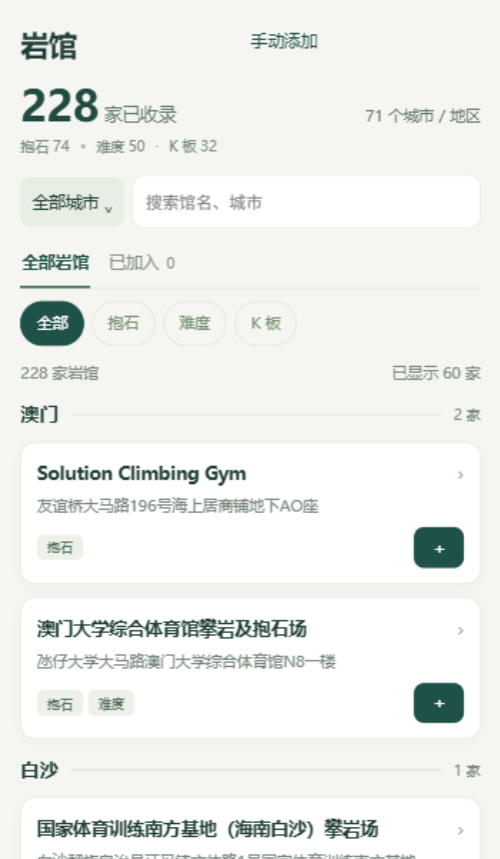
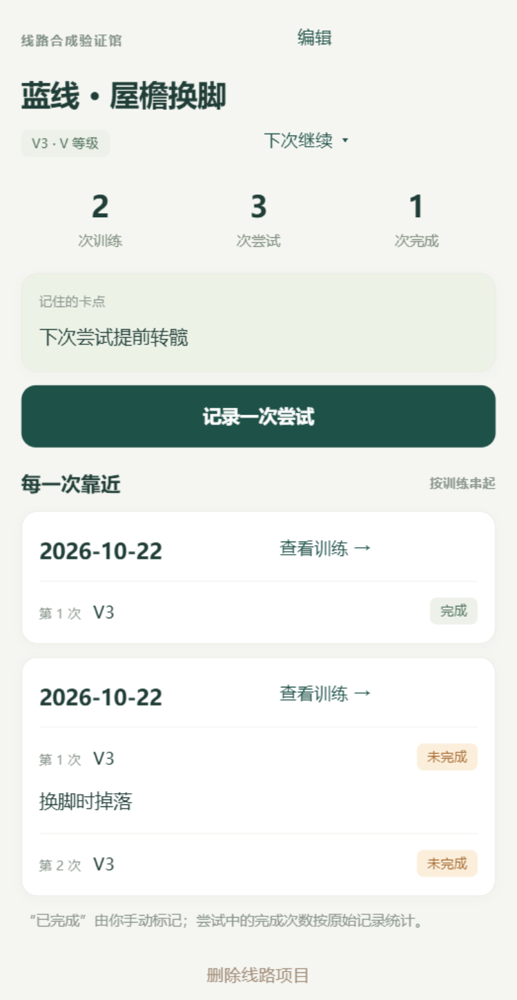

# 个人主页项目案例

## 项目卡片

### 攀迹｜攀岩训练与 AI 复盘

面向攀岩者的微信小程序，将训练、线路尝试、视频回看与下次目标串成闭环。结合结构化记录与 AI 文字复盘，并根据手机使用反馈持续简化操作。

2026.10｜训练记录与复盘｜微信小程序

## 完整案例

### 攀迹

**把一次训练的记录，接到下一次训练的行动。**

负责定义产品范围、设计训练与复盘流程，权衡成本和隐私，并依据手机使用反馈推进交互与功能迭代。当前小程序处于开发预览阶段。

#### 从什么问题出发

我围绕一个连续训练任务设计产品：记录去哪个馆、练了什么，回看某条线路的历次尝试，再确定下次继续做什么。由此将记录、回看、复盘和目标核对连成可运行流程。

#### 怎样组织产品

用户选择岩馆后记录训练，逐次保存线路尝试；同一线路可明确加入项目，跨次查看卡点和视频。训练结束后查看统计、手写或生成文字复盘，再确认下次目标。下一次训练能核对目标，让复盘有后续入口。

为减少填写，加入最近岩馆、复用上次安排、草稿恢复和连续保存。未知尝试结果单独保留，不放入完成率分母；不同岩馆的难度体系分别展示，避免给出缺乏依据的比较。

#### AI 在哪里产生价值

程序生成统计摘要与事实观察，AI 只能原样引用允许的事实，并提出谨慎假设及行动建议。模型输出经过结构、固定事实和来源引用校验，建议经用户确认或修改后才能成为目标。

调用前展示发送范围并取得单独授权，备注默认不发送，视频不发送给模型。免费资源核对失败或达到限额时暂停生成，仍可记录和手写复盘。

#### 手机操作反馈怎样改变设计

手机操作反馈指出“视频查看需要多次点击”，我把关联视频直接放进线路尝试卡片；把单段限制由 60 秒/50 MB 扩大到 5 分钟/100 MB，并补充大小、时长及保存阶段提示。开发者工具中验证了 120 秒/80 MB 合成视频的导入与播放，下一步进行原手机视频复试。

免费资源约束下，我选择训练记录可云端保存、视频留在当前设备，同时明确告知换机和清缓存的风险。这个方案需要在便利、成本与数据可恢复性之间持续评估。

#### 数据与验证

整理 228 个场所、71 个城市/地区的部分岩馆名录，保留资料来源、别名、开放条件和冲突处理记录，让用户可以筛选选馆后直接记录训练。每条资料保留来源与查询日期。

现有报告记录了 176 项自动化检查、14 页微信原生编译，以及 3 类合成场景的真实模型开发验证。下一步计划围绕首次记录、建议确认和下次目标核对开展真实任务测试，再据此决定迭代优先级。

## 界面展示

以下为开发者工具截图，训练内容为合成数据。

岩馆目录：展示筛选与资料规模，计数为 2026-10-22 公共资料快照。

快捷记录：复用上次安排时保留基础内容，重新填写本次感受与强度。开发者工具截图，合成数据。

线路项目：明确关联后跨训练查看尝试与卡点。开发者工具截图，合成数据。
